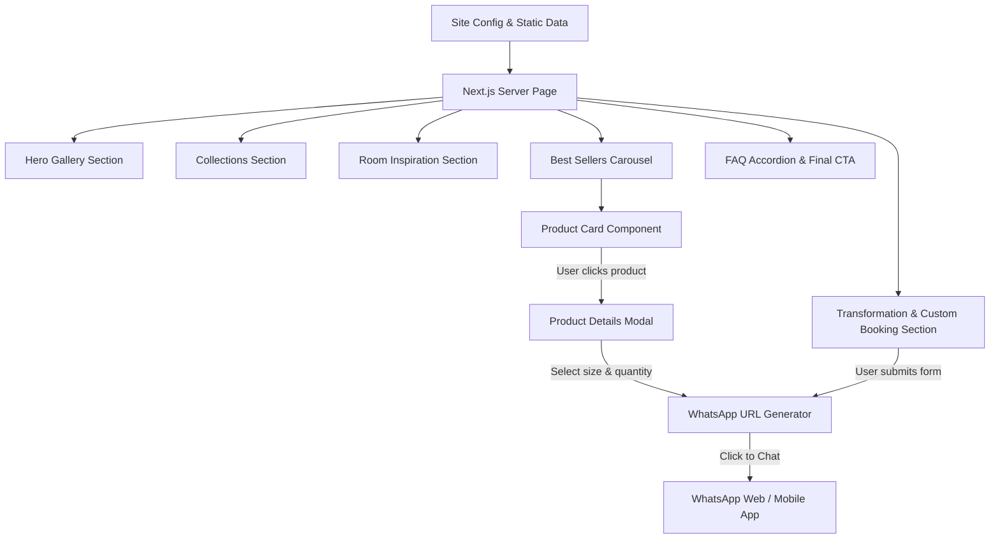

# Happy Wall — Frontend Architecture Specification

## 1. Architectural Philosophy
Following modern software engineering practices, Happy Wall is structured using a **Feature-Based Modular Architecture** built on **Next.js 14 App Router**.
- **Server Components by Default:** Layout, static content, structural headings, and SEO metadata render on the server to maximize initial load performance (LCP) and eliminate client-side hydration overhead.
- **Client Components at Leaf Nodes:** Interactivity is encapsulated strictly in dedicated client modules (e.g. `ProductCarousel`, `BeforeAfterSlider`, `CustomPosterForm`, `ProductDetailsModal`, `MobileNavigation`, `GSAPHero`).
- **Separation of Concerns:** Business data (`src/data/*`), external integrations (`src/lib/whatsapp.ts`), animations (`src/animations/*`), and visual components (`src/components/*`) remain strictly decoupled.

---

## 2. Directory Structure

```text
d:\TM_project\happywall\
├── docs/                      # Architectural & QA documentation
├── public/                    # Static optimized assets
│   ├── images/
│   │   ├── hero/              # Hero poster artworks & architectural elements
│   │   ├── collections/       # Category gallery artworks
│   │   ├── rooms/             # Room inspiration & transformation photos
│   │   ├── products/          # Best sellers & catalog mockups
│   │   └── brand/             # Logos, icons, og-image
│   └── favicon.ico
├── src/
│   ├── app/                   # Next.js App Router
│   │   ├── layout.tsx         # Root layout with fonts, metadata, JSON-LD
│   │   ├── page.tsx           # Home page orchestrating sections
│   │   ├── globals.css        # Tailwind directives and custom utility classes
│   │   ├── robots.ts          # Search engine crawler instructions
│   │   ├── sitemap.ts         # Automated XML sitemap
│   │   └── manifest.ts        # Progressive Web App manifest
│   ├── components/
│   │   ├── layout/            # Header, MobileNavigation, Footer
│   │   ├── sections/          # Hero, Collections, RoomInspiration, BestSellers,
│   │   │                      # BeforeAfter, CustomPoster, FAQ, FinalCTA
│   │   ├── products/          # ProductCard, ProductCarousel, ProductDetailsModal
│   │   ├── forms/             # CustomPosterForm with real-time validation
│   │   ├── ui/                # Button, SectionHeading, Container, WhatsAppButton
│   │   └── common/            # BeforeAfterSlider, Accordion
│   ├── data/                  # Strongly typed static data repositories
│   │   ├── site-config.ts     # Business profile, coordinates, WhatsApp config
│   │   ├── navigation.ts      # Navigation anchors
│   │   ├── collections.ts     # Category metadata & images
│   │   ├── products.ts        # Best-selling posters catalogue
│   │   ├── rooms.ts           # Room inspiration data & hot spots
│   │   └── faqs.ts            # Verified FAQ items
│   ├── lib/                   # Utility functions & helpers
│   │   ├── whatsapp.ts        # Centralized WhatsApp URL & message builder
│   │   ├── validation.ts      # Form validation logic
│   │   ├── seo.ts             # Metadata generators & JSON-LD schemas
│   │   └── utils.ts           # Class merging (clsx + twMerge)
│   ├── animations/            # GSAP configuration and timeline choreographies
│   │   └── gsap-config.ts     # GSAP registration & reduced motion check
│   └── types/                 # TypeScript type definitions
│       ├── product.ts
│       ├── collection.ts
│       └── enquiry.ts
├── tailwind.config.ts         # Tailwind CSS design tokens
├── postcss.config.js          # PostCSS configuration
├── tsconfig.json              # TypeScript strict configuration
└── package.json               # Dependencies and scripts
```

---

## 3. Data Flow Diagram



---

## 4. State Management
- **No external state management library needed** (Redux / Zustand avoided for simplicity and zero bundle bloat).
- **React Local State (`useState`)** handles:
  - Active mobile menu toggle
  - Selected product in details modal
  - Custom poster form inputs and validation errors
  - Before & After slider split percentage ($0 \dots 100\%$)
  - FAQ accordion expanded index
  - Product carousel active offset

