# Happy Wall — Data Flow Architecture

## 1. Overview
Happy Wall employs a uni-directional, deterministic data flow model. Business data (products, pricing, categories, addresses, sizes, and FAQs) resides in immutable, strongly-typed static repositories within `src/data/`. This eliminates runtime database overhead, delivers near-instant Time to First Byte (TTFB), and guarantees reliable static generation.

---

## 2. Customer Journey & State Transitions

```mermaid
sequenceDiagram
    autonumber
    actor Customer as Customer / Visitor
    participant Browser as Browser Client
    participant Modal as Product Details Modal
    participant Form as Custom Poster Form
    participant WhatsApp as WhatsApp Click-to-Chat
    participant Owner as Happy Wall Team (+91 73395 64538)

    Customer->>Browser: Enters site & explores Hero / Collections
    Note over Browser: GSAP entrance & lazy-loaded WebP posters render
    
    rect rgb(28, 28, 28)
        Note over Browser,Modal: Best-Selling Product Flow
        Customer->>Browser: Clicks "Quick View & Order" on "Minimal Quote Poster"
        Browser->>Modal: Opens Modal with Product details
        Customer->>Modal: Selects size: A3 Standard (₹ 499)
        Customer->>Modal: Adjusts quantity: 2
        Note over Modal: Dynamic recalculation: Total = ₹ 998
        Customer->>Modal: Clicks "Order via WhatsApp"
        Modal->>WhatsApp: Launches wa.me with formatted order payload
    end

    rect rgb(35, 35, 35)
        Note over Browser,Form: Custom Poster Booking Flow
        Customer->>Browser: Scrolls to "Book Your Custom Poster"
        Customer->>Form: Enters Name, WhatsApp No, Size (A3+), and Art Description
        Form->>Form: Validates Indian 10-digit number & required fields
        Customer->>Form: Clicks "Send via WhatsApp →"
        Form->>WhatsApp: Launches wa.me with custom booking requirements
    end

    WhatsApp->>Owner: Customer hits Send in WhatsApp conversation
    Owner->>Customer: Verifies image resolution, shares UPI QR, confirms delivery
```



---

## 3. Data Schemas & Payload Contracts

### 3.1 Product Order WhatsApp Payload
```text
*NEW POSTER ORDER INQUIRY — HAPPY WALLS* 🖼️
----------------------------------------
📌 *Product:* Minimal Quote Poster
🆔 *Item ID:* hw-quote-02
📐 *Size Selected:* A3 (29.7 × 42 cm)
🔢 *Quantity:* 2
💰 *Estimated Total:* ₹998
----------------------------------------
Could you please confirm availability and provide payment details (UPI/GPay)? Thank you!
```

### 3.2 Custom Poster Booking Payload
```text
*CUSTOM POSTER BOOKING ENQUIRY — HAPPY WALLS* 🎨
----------------------------------------
👤 *Customer Name:* Rahul Sharma
📱 *WhatsApp / Phone:* 9876543210
✉️ *Email:* rahul@example.com
📐 *Preferred Size:* A3+
📝 *Design Vision / Message:*
"I want a high-resolution print of a custom cyberpunk synthwave skyline for my gaming setup."
----------------------------------------
I would like to discuss custom artwork creation, paper finish, and pricing with your team.
```

